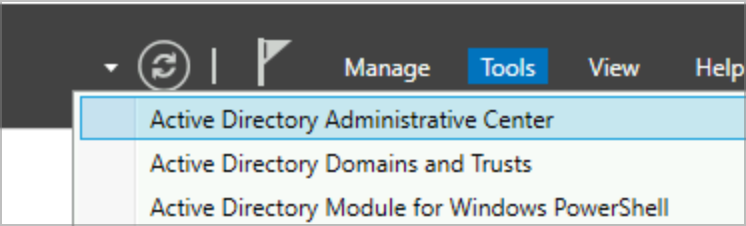
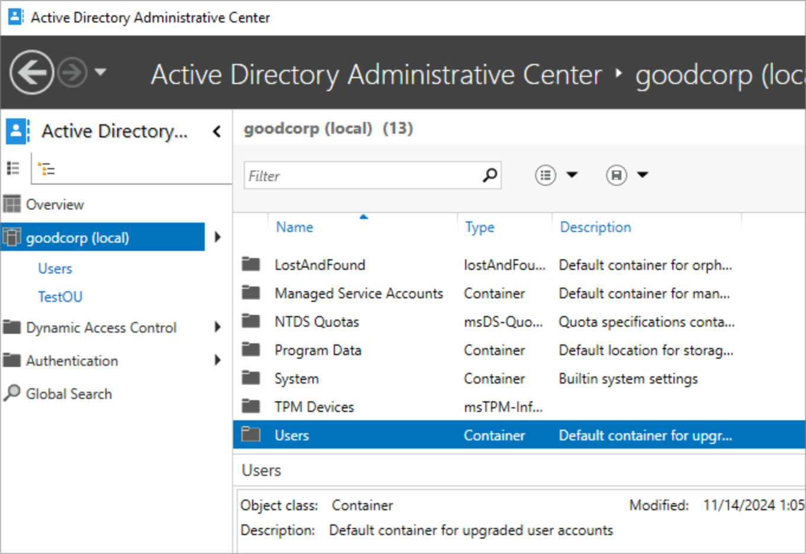
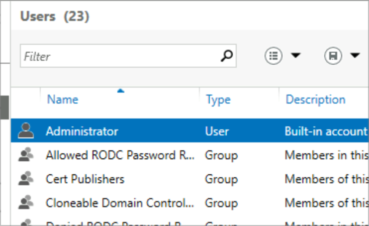
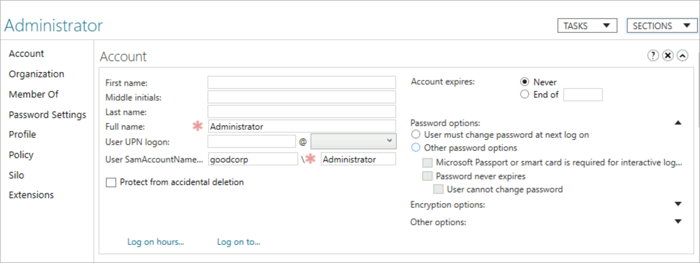
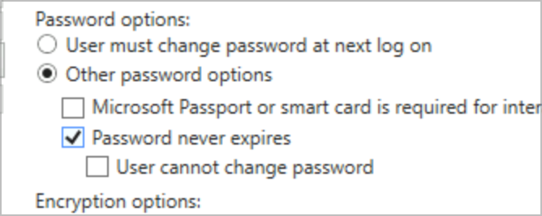
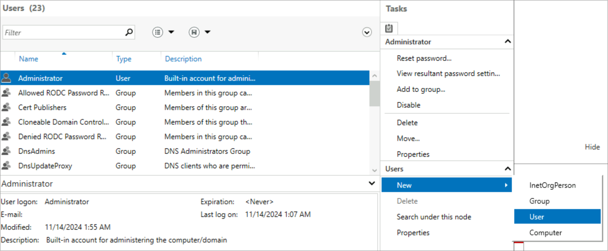
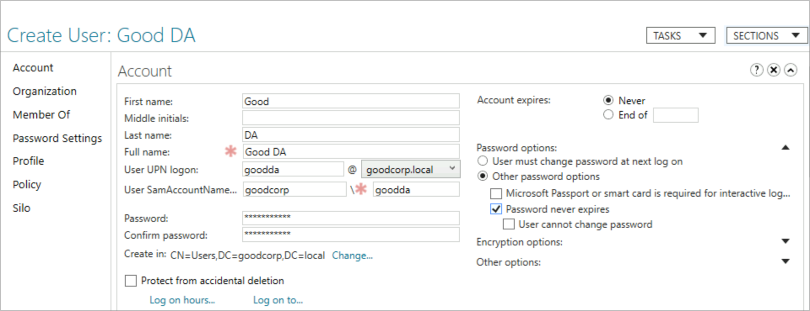
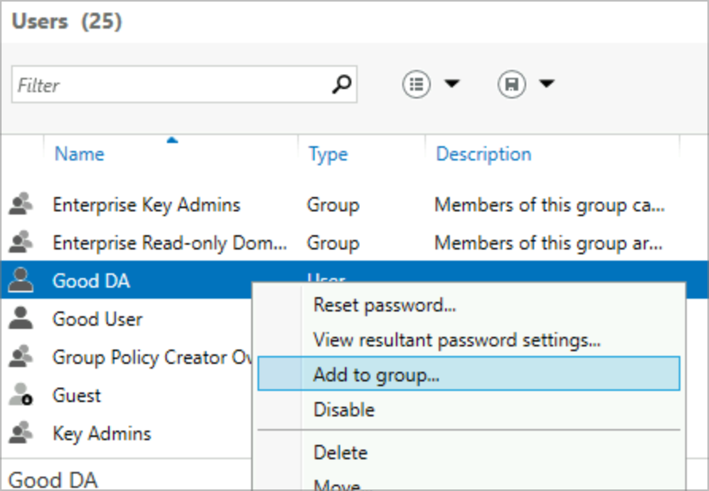
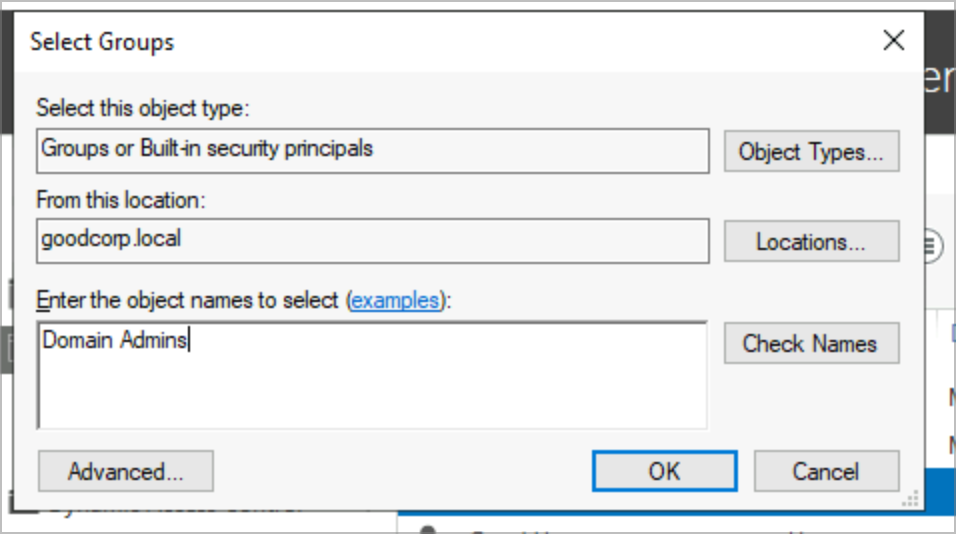
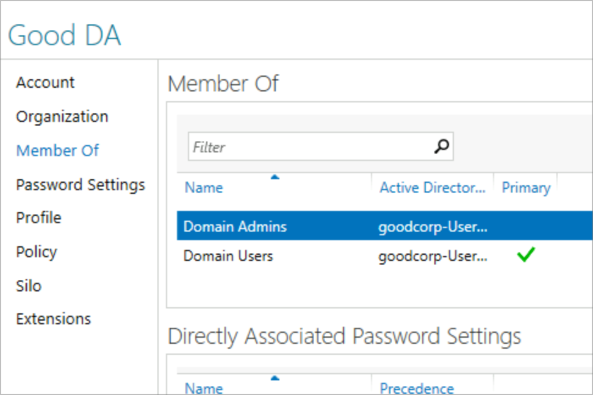

# Lab 02 – Creating Users, Admins and Groups

Account administration is the most common helpdesk task in an AD environment. In this lab I used the **Active Directory Administrative Center (ADAC)** to adjust the Administrator account, create a standard user, and create a separate Domain Admin account.

## Objectives

- Navigate the Active Directory Administrative Center
- Set *Password never expires* on the built-in Administrator
- Create a standard domain user (`gooduser`)
- Create a Domain Admin (`goodda`) and add it to **Domain Admins**

## Environment

| Item | Value |
|---|---|
| Domain | `goodcorp.local` |
| Domain Controller | Windows Server (AD DS + DNS) |
| Workstation | Windows client, domain-joined |
| Admin account | `goodda` (Domain Admin) |
| Standard user | `gooduser` |

## Steps

### Step 1 – Open ADAC

**Server Manager → Tools → Active Directory Administrative Center**

```powershell
Start-ADAdministrativeCenter
```


<p>

</p>

### Step 2 – Administrator: Password never expires

ADAC → `goodcorp (local)` → **Users** → *Administrator* → **Account** section → check **Password never expires** → OK.

```powershell
Set-ADUser -Identity Administrator -PasswordNeverExpires $true
```


<p>




</p>

### Step 3 – Create a standard user

**Users → New → User**: First name *Good*, Last name *User*, logon `gooduser`, set a password, uncheck *User must change password at next logon*.

```powershell
New-ADUser -Name "Good User" -GivenName "Good" -Surname "User" -SamAccountName "gooduser" `
  -UserPrincipalName "gooduser@goodcorp.local" `
  -AccountPassword (Read-Host -AsSecureString "Password") -Enabled $true
```


<p>

</p>

### Step 4 – Create a Domain Admin

Create `goodda` the same way, then right-click → **Add to group… → Domain Admins → Check Names → OK**. Confirm on the **Member Of** tab.

```powershell
New-ADUser -Name "Good DA" -GivenName "Good" -Surname "DA" -SamAccountName "goodda" `
  -UserPrincipalName "goodda@goodcorp.local" `
  -AccountPassword (Read-Host -AsSecureString "Password") -Enabled $true
Add-ADGroupMember -Identity "Domain Admins" -Members "goodda"
```


<p>




</p>

## Verification

- `gooduser` and `goodda` appear under **Users** and are enabled
- `goodda` shows **Domain Admins** on the *Member Of* tab
- `Get-ADGroupMember "Domain Admins"` lists `goodda`

## Troubleshooting Notes

- "Password does not meet complexity requirements": use length + upper/lower + number/symbol.
- Account can't log in: check it's **enabled** and not locked out (`Unlock-ADAccount`).
- Best practice: separate daily-use and admin accounts instead of using the built-in Administrator.

## Skills Demonstrated

- User provisioning in ADAC & PowerShell
- Security group membership
- Password policy settings
- Least-privilege account separation


---


