# Lab 05 – Endpoint Policy: Restricting PowerShell Scripts

Standard users shouldn't be able to run arbitrary scripts on company PCs. In this lab I used Group Policy to allow **only signed PowerShell scripts** for everyone in the domain, turned on PowerShell logging, and confirmed the block from the user's side and in Event Viewer.

## Objectives

- Baseline: confirm a standard user can run a script
- Create a GPO that allows only signed scripts
- Push it remotely and confirm the block
- Create a GPO to enable PowerShell Script Block & Module logging
- Review the PowerShell event log

## Environment

| Item | Value |
|---|---|
| Domain | `goodcorp.local` |
| Domain Controller | Windows Server (AD DS + DNS) |
| Workstation | Windows client, domain-joined |
| Admin account | `goodda` (Domain Admin) |
| Standard user | `gooduser` |

## Steps

### Step 1 – Baseline test as gooduser

RDP in as `gooduser`, create `Desktop\TestScript.ps1` containing `Write-Output "I can execute scripts!"` and run it. It runs.


<p>
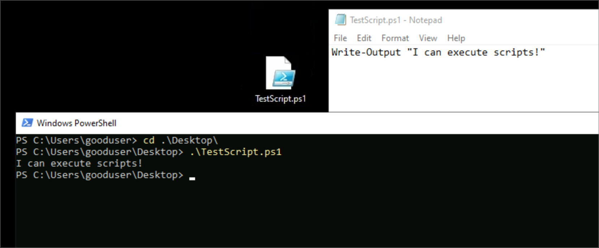
</p>

### Step 2 – GPO: Restrict PowerShell Script Execution

GPMC → **Create a GPO in this domain, and Link it here** → *Restrict PowerShell Script Execution* → Edit:

`Computer Configuration → Policies → Administrative Templates → Windows Components → Windows PowerShell → Turn on Script Execution` → **Enabled: Allow only signed scripts**.

Before the update, `Get-ExecutionPolicy -List` on the workstation still shows **Undefined**.


<p>
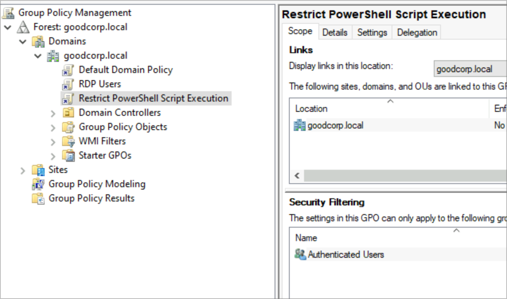
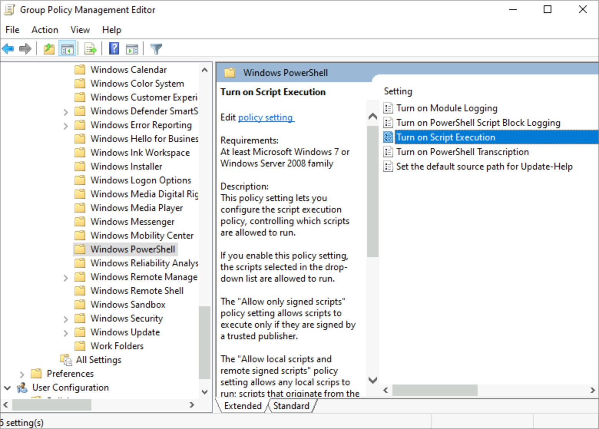
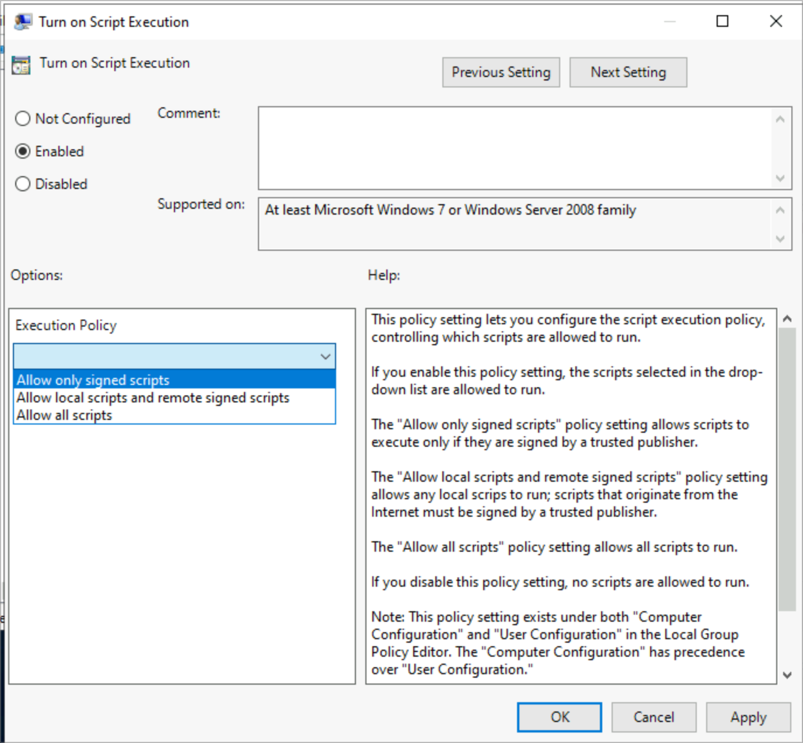
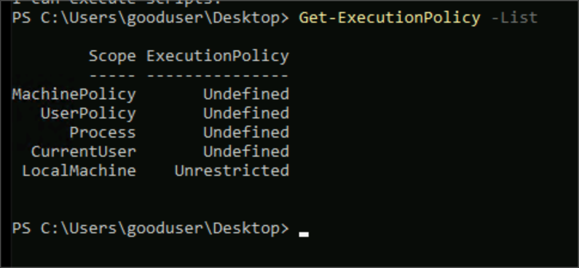
</p>

### Step 3 – Push the policy & test

```powershell
Invoke-Command -ComputerName "<workstation>" -ScriptBlock { gpupdate /force }
```
In a **new** PowerShell window as `gooduser`, the script is now blocked: *"…is not digitally signed."*


<p>
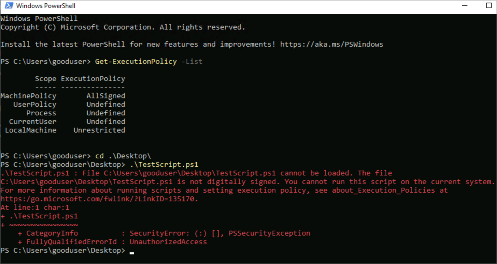
</p>

### Step 4 – GPO: Enable PowerShell Logging

New GPO *Enable PowerShell Logging* → same Windows PowerShell node → enable **Turn on PowerShell Script Block Logging** (with start/stop events) and **Turn on Module Logging** (module name `*`).

```powershell
New-GPO -Name "Enable PowerShell Logging" | New-GPLink -Target "DC=goodcorp,DC=local"
Set-GPRegistryValue -Name "Enable PowerShell Logging" -Key "HKLM\SOFTWARE\Policies\Microsoft\Windows\PowerShell\ScriptBlockLogging" -ValueName "EnableScriptBlockLogging" -Type DWORD -Value 1
Set-GPRegistryValue -Name "Enable PowerShell Logging" -Key "HKLM\SOFTWARE\Policies\Microsoft\Windows\PowerShell\ModuleLogging" -ValueName "EnableModuleLogging" -Type DWORD -Value 1
```


<p>
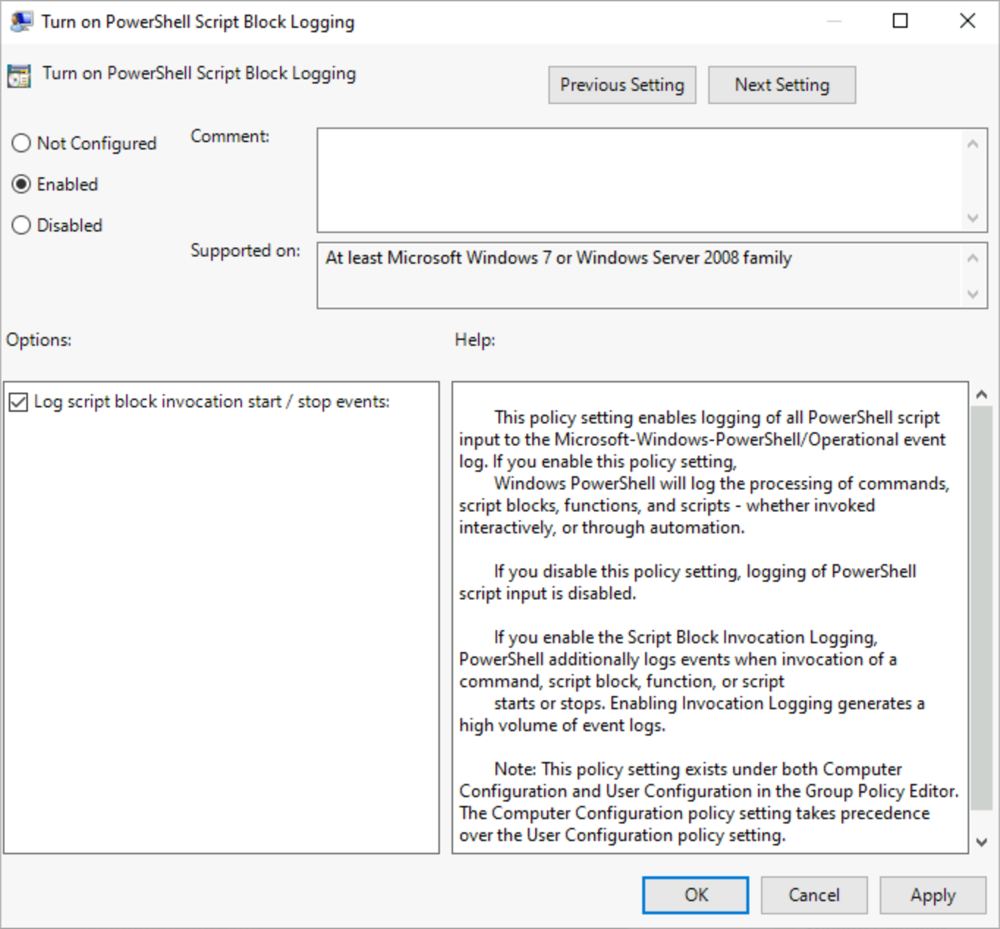
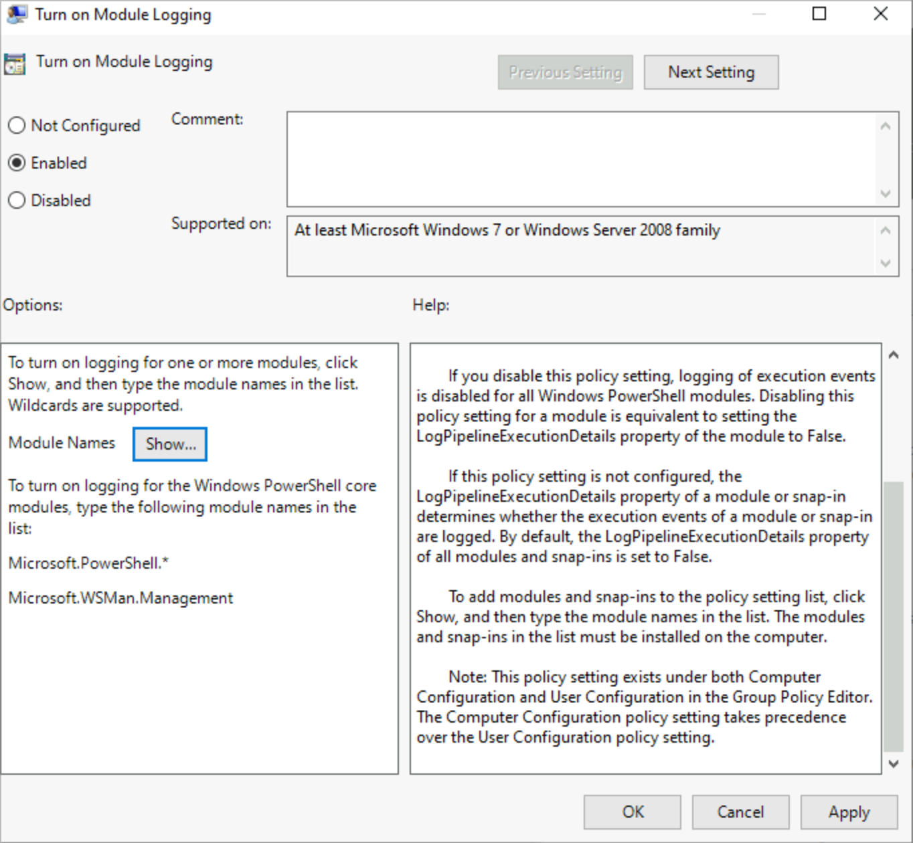
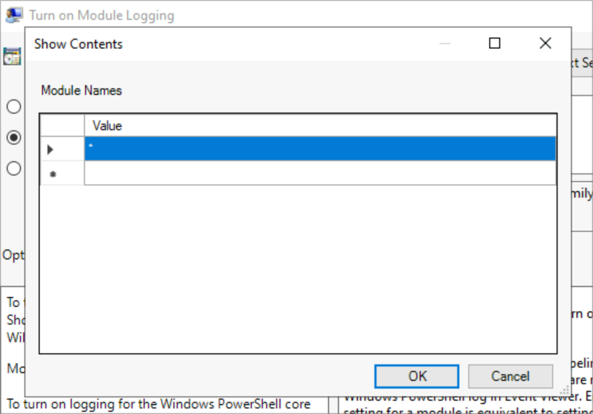
</p>

### Step 5 – Confirm the policies landed

After another remote `gpupdate`, retry the script a few times as `gooduser` (still blocked) and confirm logging is on:
```powershell
Get-ItemProperty -Path "HKLM:\Software\Policies\Microsoft\Windows\PowerShell\ScriptBlockLogging" -Name "EnableScriptBlockLogging"
```


<p>
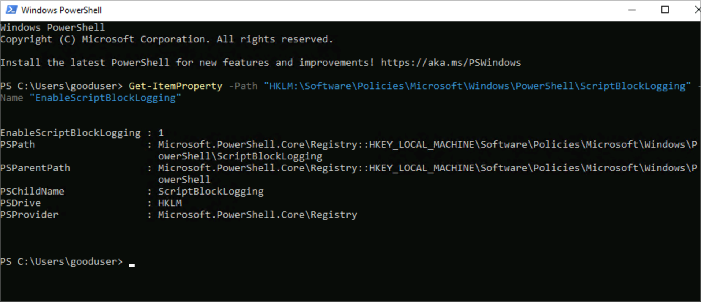
</p>

### Step 6 – Review the logs

**Event Viewer → Applications and Services Logs → Microsoft → Windows → PowerShell → Operational** shows the blocked attempts by `gooduser`.


<p>
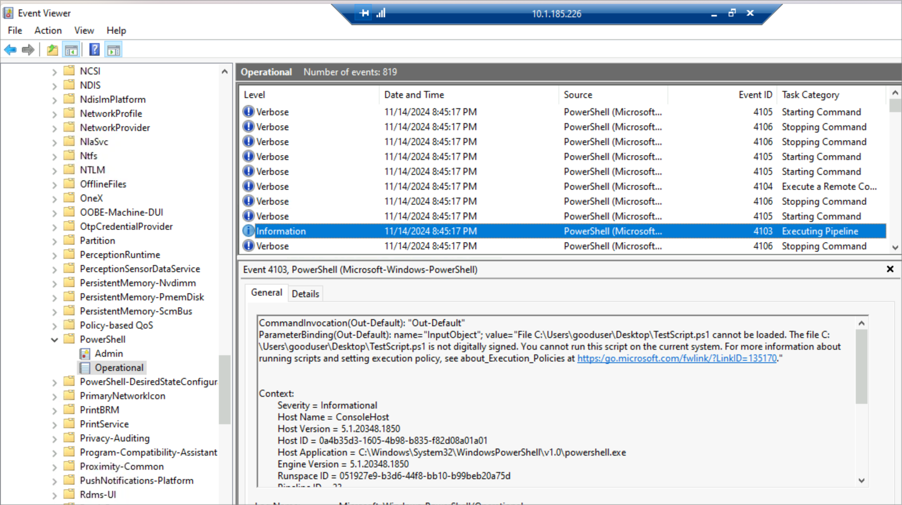
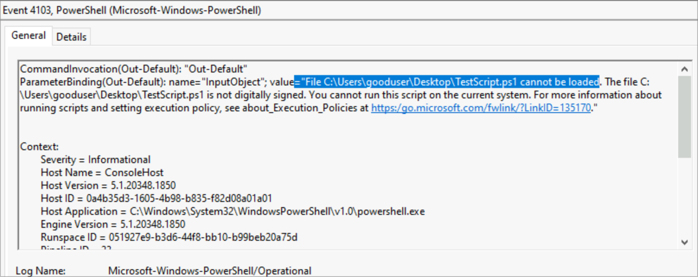
</p>

## Verification

- `Get-ExecutionPolicy -List` shows **MachinePolicy = AllSigned**
- Unsigned script fails for `gooduser`
- PowerShell/Operational log records the attempts

## Troubleshooting Notes

- Policy not applying? Open a **new** PowerShell window, run `gpupdate /force`, reboot if needed, and check `gpresult /r`.
- PowerShell logging is verbose. Watch the event log size so it does not fill the disk.
- Test every GPO on one machine before rolling it out widely.

## Skills Demonstrated

- Endpoint hardening with GPO
- PowerShell execution policy
- Remote `gpupdate` with `Invoke-Command`
- Event Viewer navigation


---

*Lab guide and screenshots from the Level Effect SOC100-1 course (Windows Enterprise Administration). Documentation written by me. Lab passwords are replaced with `<password>`.*
