# Lab 07 – Remote Management (RMM) with PowerShell

Helpdesk teams fix most problems without walking to the user's desk. In this lab I enabled **WinRM / PowerShell Remoting** through Group Policy and then used it from the DC to inspect a workstation, kill a hung app, restart a service, reboot the PC, and pull a log report.

## Objectives

- Enable WinRM and the required firewall rules via GPO
- Retrieve OS info remotely with CIM
- List and stop a process on the user's PC
- Restart the Print Spooler service remotely
- Reboot the workstation remotely
- Export PowerShell logs to an HTML report

## Environment

| Item | Value |
|---|---|
| Domain | `goodcorp.local` |
| Domain Controller | Windows Server (AD DS + DNS) |
| Workstation | Windows client, domain-joined |
| Admin account | `goodda` (Domain Admin) |
| Standard user | `gooduser` |

## Steps

### Step 1 – GPO: Enable Remote PowerShell Management

New GPO *Enable Remote PowerShell Management*:
- `Administrative Templates → Windows Components → Windows Remote Management (WinRM) → WinRM Service → Allow remote server management through WinRM` → **Enabled**, IPv4/IPv6 filter `*`
- `Windows Defender Firewall with Advanced Security → Inbound Rules` → predefined **Windows Remote Management (HTTP-In)** and **Remote Administration (RPC)**

RDP in once as `goodda`, run `gpupdate /force`; after that, a remote `gpupdate` from the DC succeeds.


<p>
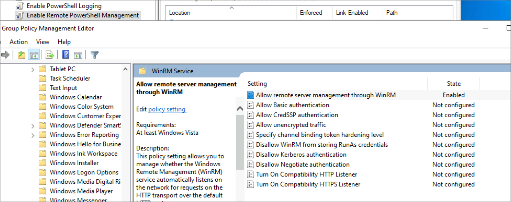
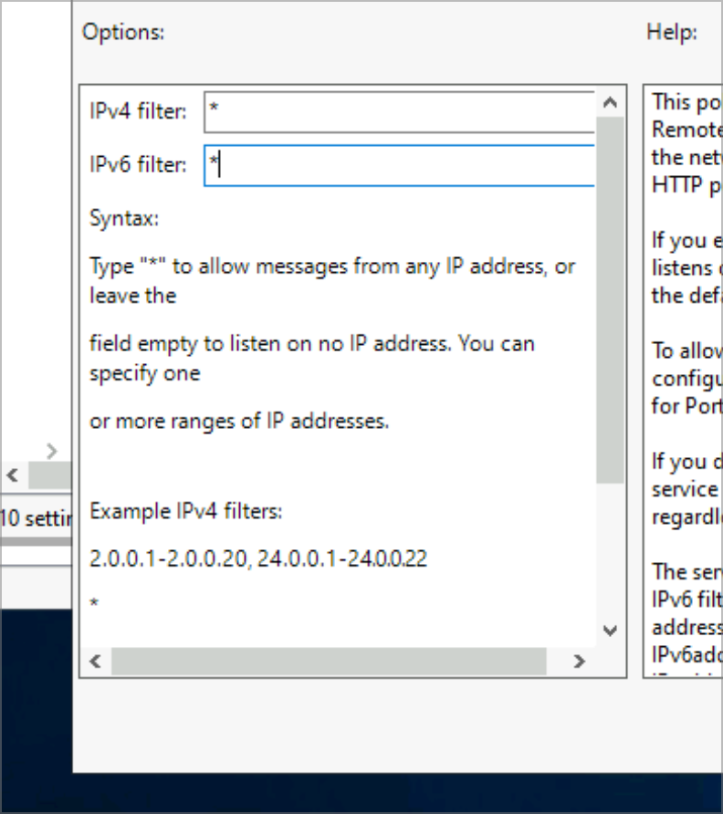
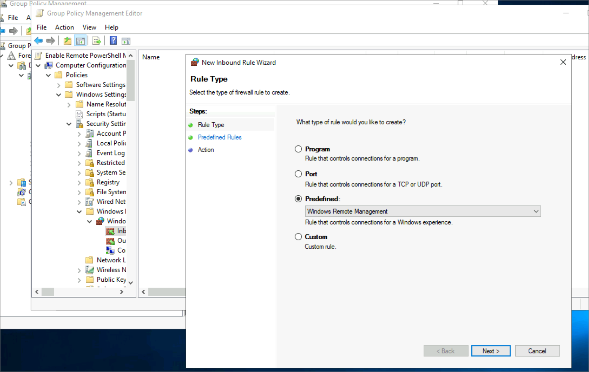
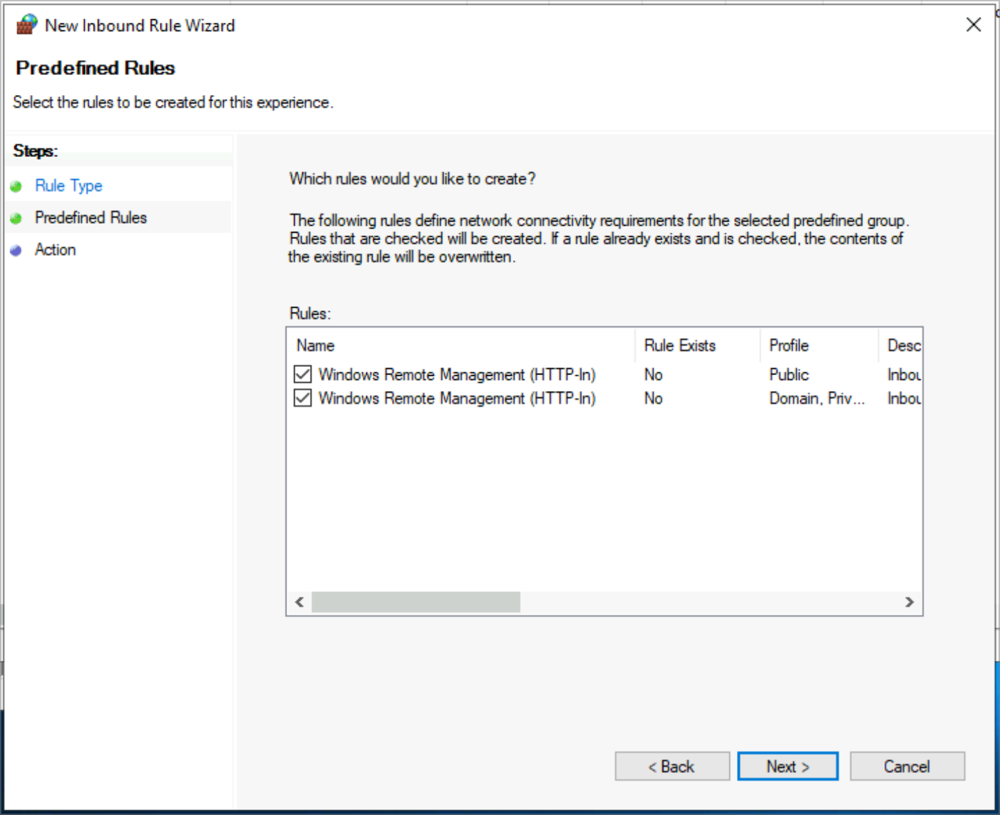
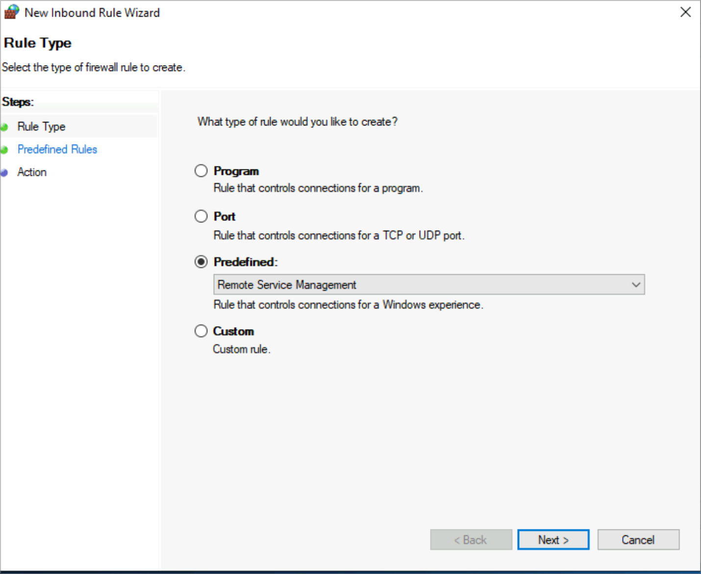
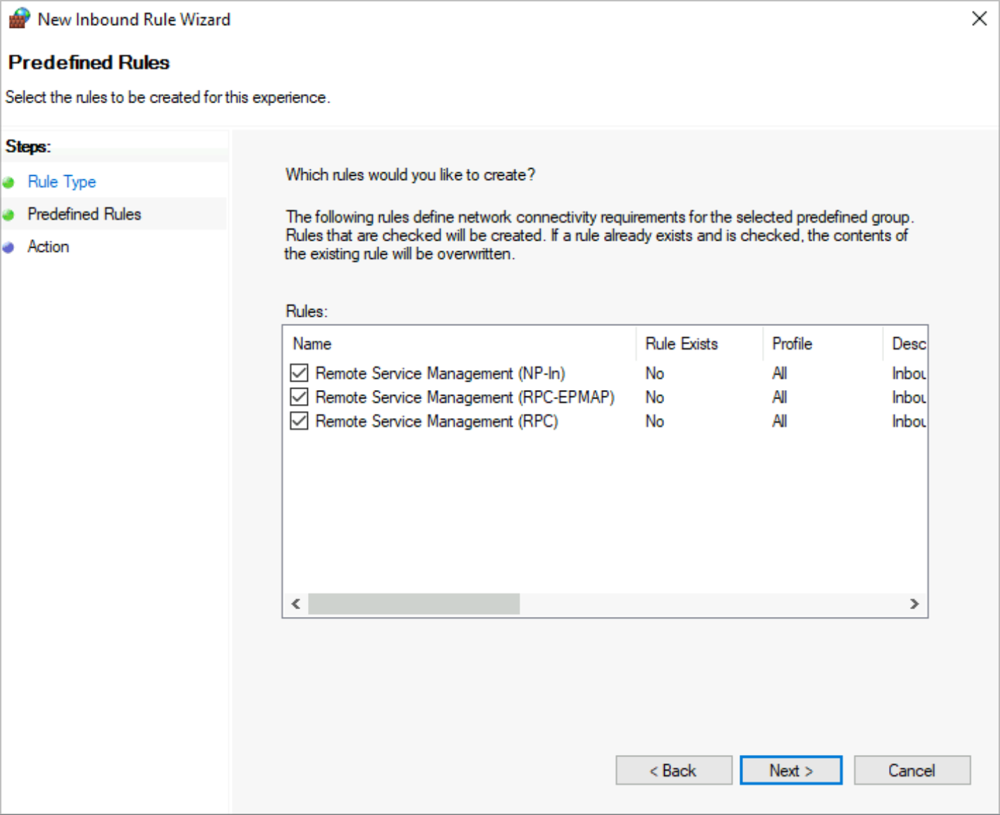
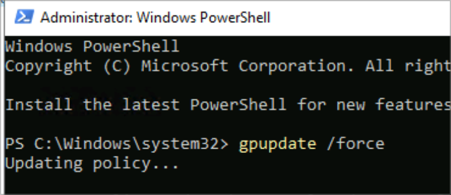
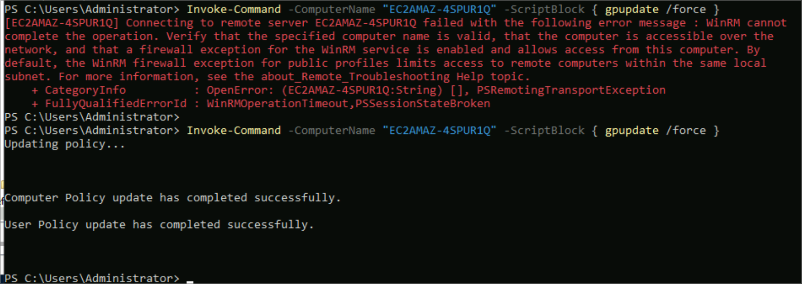
</p>

### Step 2 – Remote support commands from the DC

```powershell
# System info
Invoke-Command -ComputerName <workstation> -ScriptBlock { Get-CimInstance -ClassName Win32_OperatingSystem }

# Running processes
Invoke-Command -ComputerName <workstation> -ScriptBlock { Get-Process }

# Find and kill the user's Notepad
$p = Invoke-Command -ComputerName <workstation> -ScriptBlock { Get-Process -Name "notepad" }
Invoke-Command -ComputerName <workstation> -ScriptBlock { Stop-Process -Id $using:p.Id }

# Restart the Print Spooler (classic "my printer is stuck" fix)
Invoke-Command -ComputerName <workstation> -ScriptBlock { Restart-Service -Name "Spooler" }

# Reboot the PC
Invoke-Command -ComputerName <workstation> -ScriptBlock { Restart-Computer -Force }
```


<p>
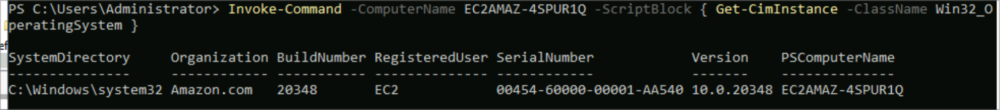
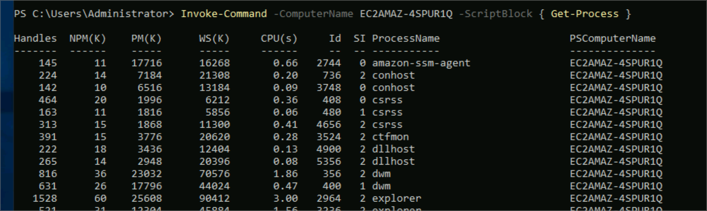
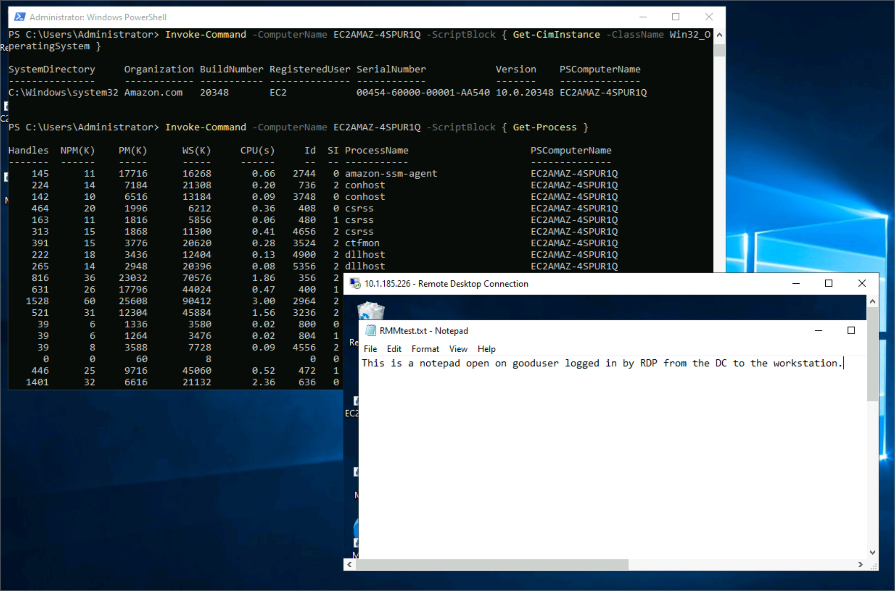
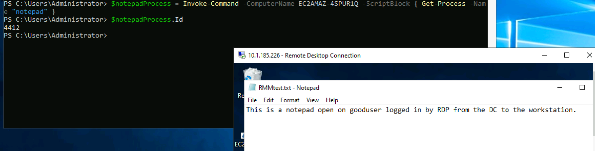
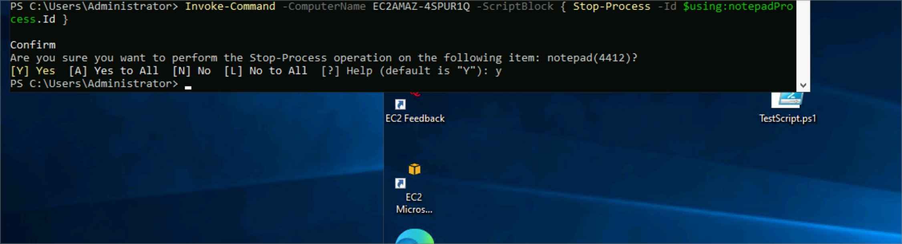
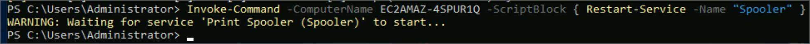
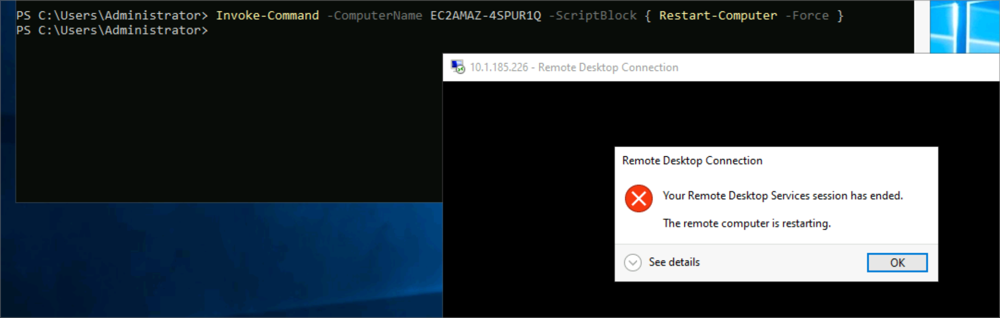
</p>

### Step 3 – Pull a log report

```powershell
Invoke-Command -ComputerName <workstation> -ScriptBlock {
  Get-WinEvent -FilterHashtable @{ LogName = "Microsoft-Windows-PowerShell/Operational"; Id = 4104 }
} | Select-Object TimeCreated, Id, Message |
  ConvertTo-Html -Property TimeCreated, Id, Message -Title "PowerShell Script Execution Log" |
  Out-File C:\SharedData\PowerShellScriptLog.html
```
Opened the HTML report in a browser to review it.


<p>
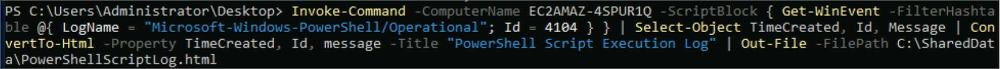
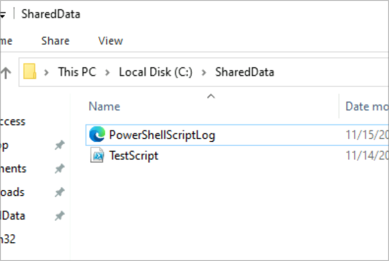
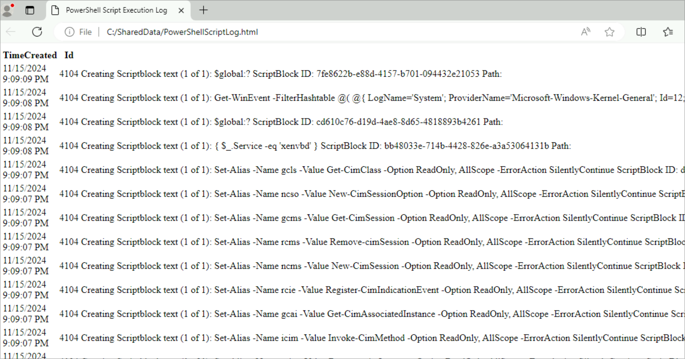
</p>

## Verification

- Remote `gpupdate` returns successfully
- Notepad closes on the user's session after `Stop-Process`
- Spooler restarts and the workstation reboots on command
- HTML report generated in `C:\SharedData`

## Troubleshooting Notes

- *"WinRM cannot complete the operation"*: GPO not applied yet, or firewall rule missing. RDP in and `gpupdate /force`, then test with `Test-WSMan <workstation>`.
- Use `$using:` to pass local variables into a remote script block.

## Skills Demonstrated

- WinRM / PowerShell Remoting
- Remote troubleshooting (processes, services, reboots)
- GPO-managed firewall rules
- Log collection & reporting


---

*Lab guide and screenshots from the Level Effect SOC100-1 course (Windows Enterprise Administration). Documentation written by me. Lab passwords are replaced with `<password>`.*
