# Lab 08 – Automated Software Deployment with Chocolatey

Installing apps one PC at a time doesn't scale. In this lab I installed the **Chocolatey** package manager on a workstation remotely and used one-line commands to deploy Notepad++, Sysinternals, 7-Zip and Adobe Reader, then confirmed the user could launch them.

## Objectives

- Relax the script-execution GPO for the lab
- Install Chocolatey remotely
- Test-install a single app (Notepad++)
- Deploy several apps with one command
- Verify as the end user

## Environment

| Item | Value |
|---|---|
| Domain | `goodcorp.local` |
| Domain Controller | Windows Server (AD DS + DNS) |
| Workstation | Windows client, domain-joined |
| Admin account | `goodda` (Domain Admin) |
| Standard user | `gooduser` |

## Steps

### Prep – Relax the script policy

Set the *Restrict PowerShell Script Execution* GPO from [Lab 05](../05-powershell-security-policy/) to **Not Configured** and run a remote `gpupdate`.


<p>
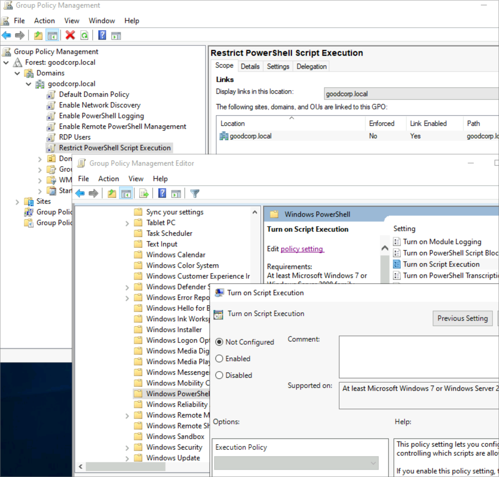
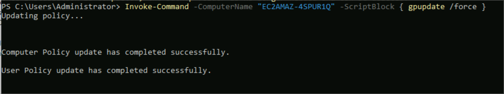
</p>

### Step 1 – Install Chocolatey remotely

```powershell
Invoke-Command -ComputerName <workstation> -ScriptBlock {
  Set-ExecutionPolicy Bypass -Scope Process -Force
  [System.Net.ServicePointManager]::SecurityProtocol = [System.Net.ServicePointManager]::SecurityProtocol -bor 3072
  iex ((New-Object System.Net.WebClient).DownloadString('https://community.chocolatey.org/install.ps1'))
}
Invoke-Command -ComputerName <workstation> -ScriptBlock { choco --version }
```


<p>
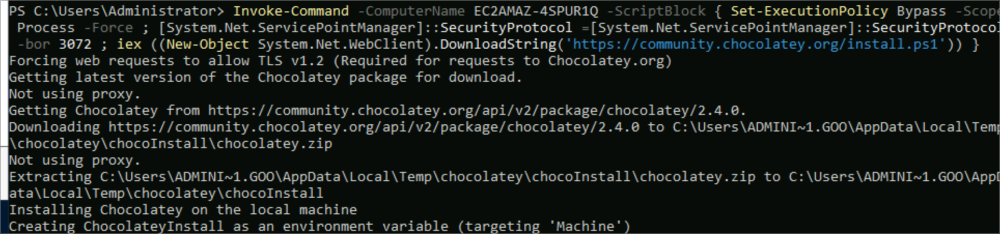
</p>

### Step 2 – Test install: Notepad++

```powershell
Invoke-Command -ComputerName <workstation> -ScriptBlock { choco install notepadplusplus -y }
Invoke-Command -ComputerName <workstation> -ScriptBlock { choco list }
```
RDP in as `gooduser`: Notepad++ is in the Start menu and opens.


<p>
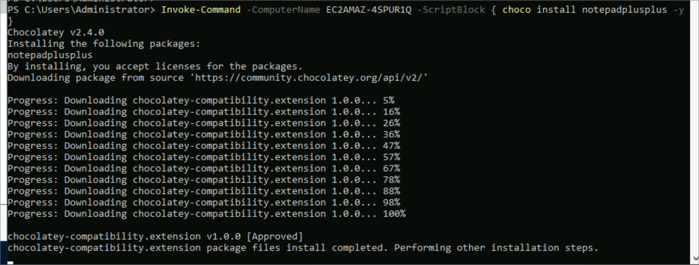
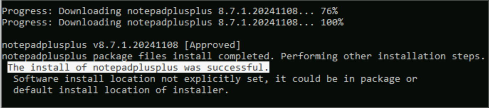
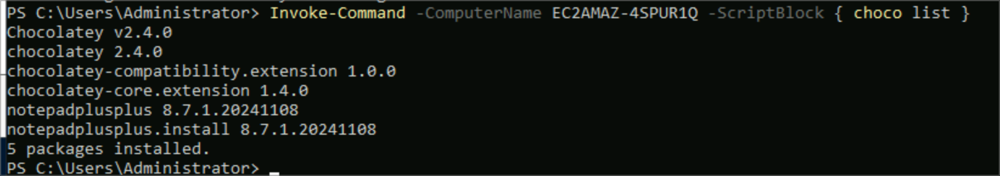
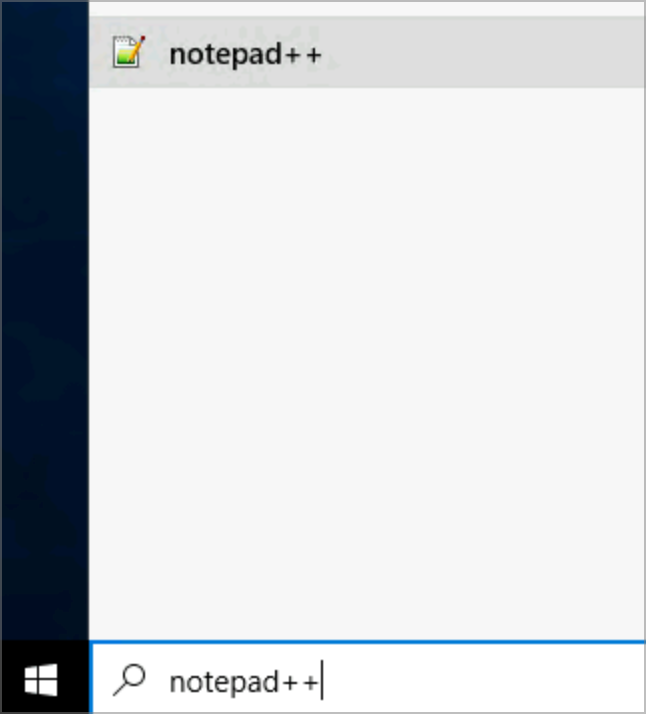
</p>

### Step 3 – Deploy multiple apps at once

```powershell
Invoke-Command -ComputerName <workstation> -ScriptBlock {
  choco install sysinternals -y ; choco install 7zip -y ; choco install adobereader -y
}
# Sysinternals package had a known checksum bug at the time:
Invoke-Command -ComputerName <workstation> -ScriptBlock { choco install sysinternals -y --ignore-checksums }
```
As `gooduser`, opened `C:\ProgramData\chocolatey\bin` and launched **autoruns64** to confirm it works.


<p>
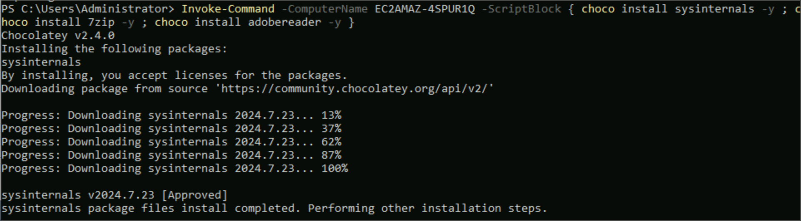
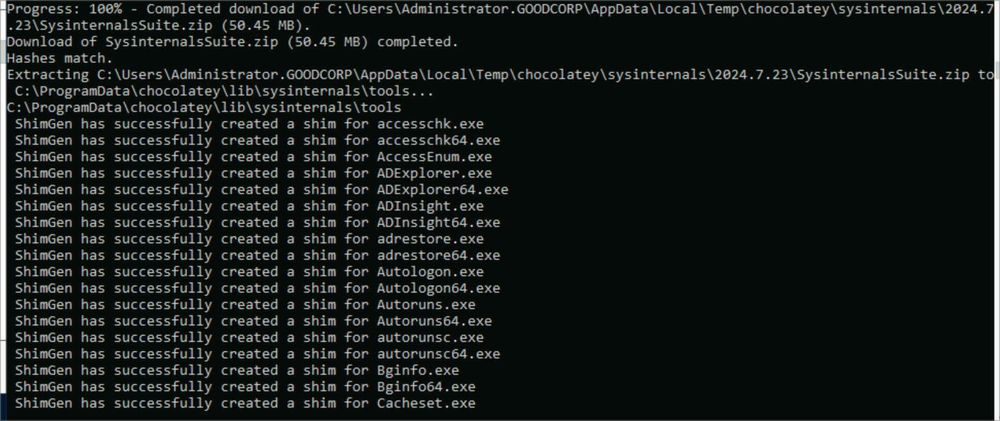
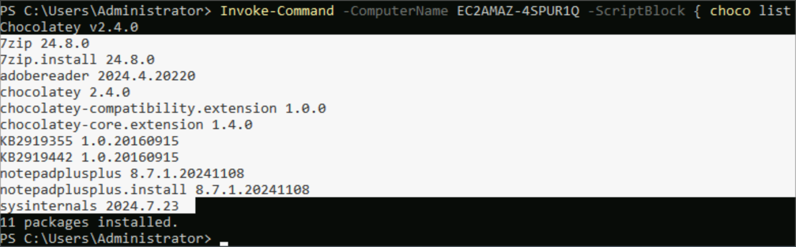
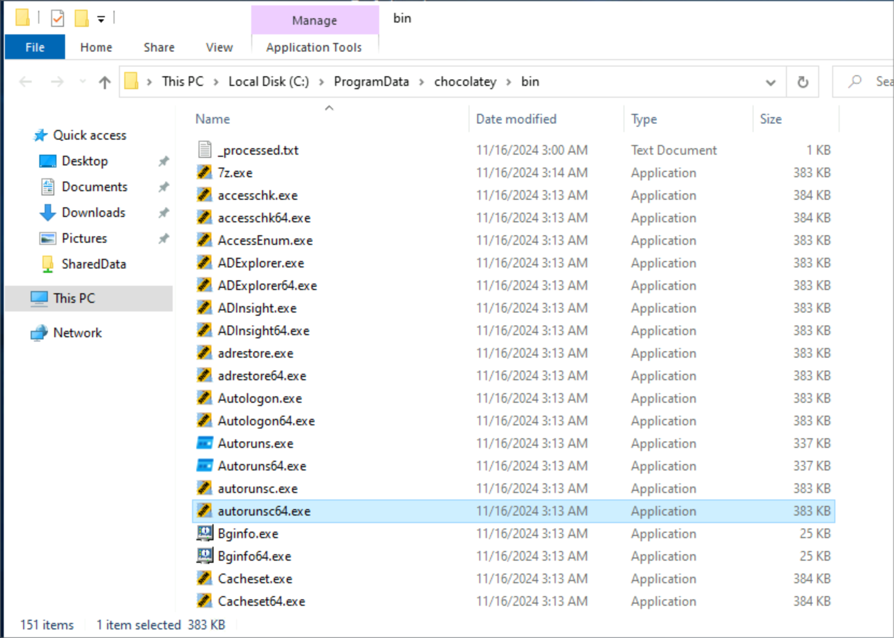
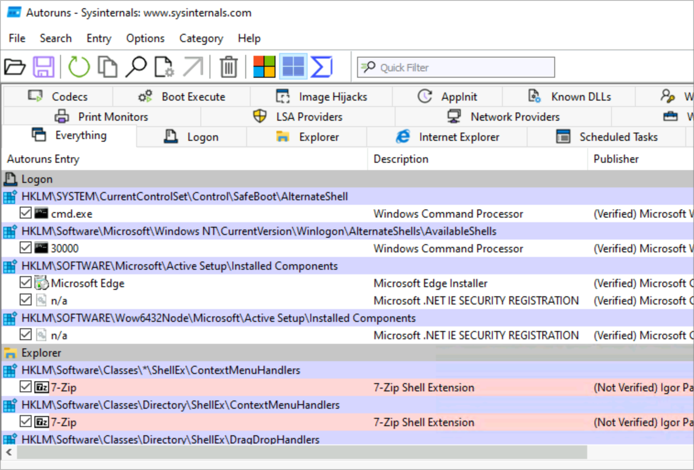
</p>

## Verification

- `choco list` shows notepadplusplus, sysinternals, 7zip, adobereader
- Apps launch for the standard user

## Troubleshooting Notes

- Install fails with a checksum error: verify the package source; use `--ignore-checksums` **only** for a known, trusted bug.
- Script blocked: the execution-policy GPO is still applied (`Get-ExecutionPolicy -List`).
- Re-enable the script restriction GPO after the lab.

## Skills Demonstrated

- Package management with Chocolatey
- Remote, scripted software deployment
- Working with execution policy
- End-user verification


---

*Lab guide and screenshots from the Level Effect SOC100-1 course (Windows Enterprise Administration). Documentation written by me. Lab passwords are replaced with `<password>`.*
